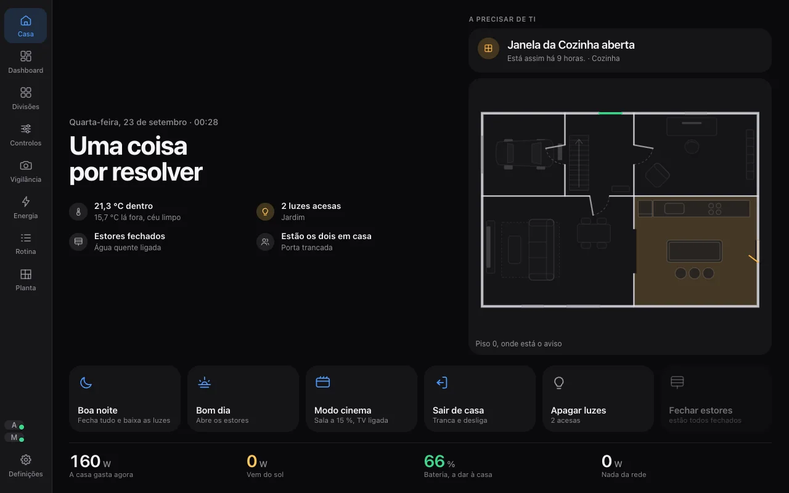
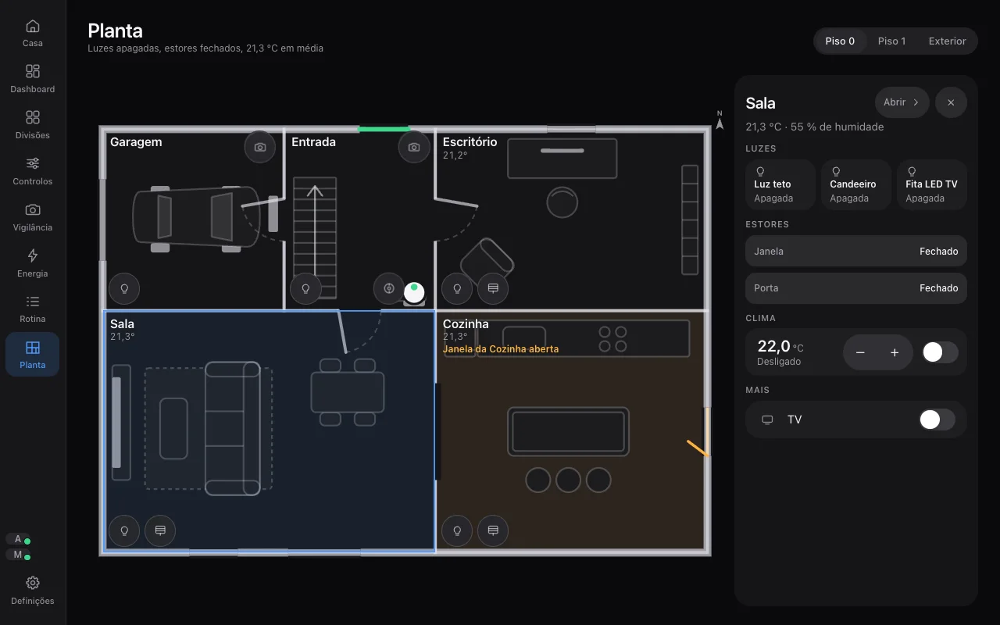
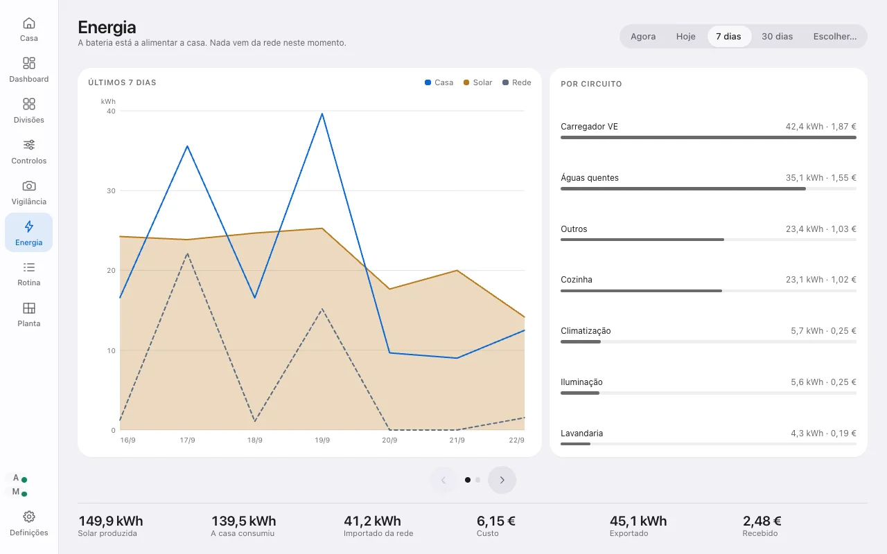
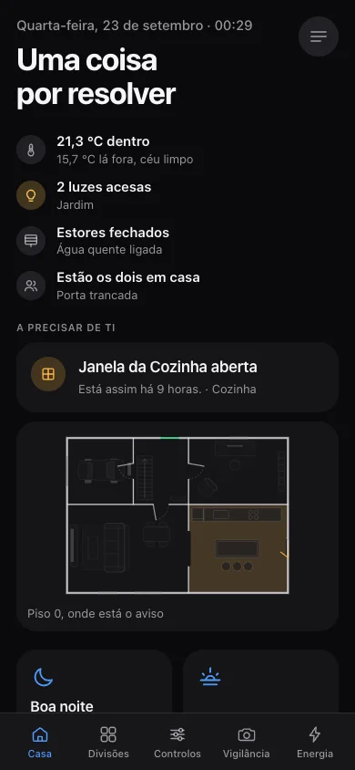

# Nook · Demo do painel de domótica

Demonstração completa do painel **Nook**: um Home Assistant em Docker, com uma
moradia portuguesa inteiramente simulada e um painel próprio pensado para três
ecrãs (tablet de parede, televisão e telemóvel). Quem abre a demo não faz login
nem instala nada: entra como visitante e mexe na casa.



**Home Assistant 2026.9** · **Python** (integrações) · **JavaScript e CSS sem
dependências nem build** (painel) · **Docker Compose**

## Índice

- [O painel](#o-painel)
- [A casa simulada](#a-casa-simulada)
- [Arranque rápido](#arranque-rápido)
- [Onde está cada coisa](#onde-está-cada-coisa)
- [Estrutura do repositório](#estrutura-do-repositório)
- [Como funciona](#como-funciona)
- [Publicar a demo](#publicar-a-demo)
- [Documentação](#documentação)
- [Licença](#licença)

## O painel

O painel (`casa_os`) serve-se em `/casa` e adapta-se ao ecrã onde está:

| Ecrã | Tamanho de referência | Comportamento |
|---|---|---|
| Tablet de parede ou computador | 1024 × 768 | Ocupa o ecrã inteiro, sem rolar; alvos de toque de 44 px |
| Televisão | 1920 × 1080 | Letra e espaços 1,6 vezes maiores, para ler do sofá; repouso à noite |
| Telemóvel | 375 × 812 | Coluna única que rola; separadores em baixo |

| Secção | O que faz |
|---|---|
| **Casa** | Responde de relance a "está tudo bem?": um veredicto, quatro factos (temperatura, luzes, estores, quem está em casa), os avisos com contexto e a casa desenhada em miniatura |
| **Divisões** | Cada divisão com o seu estado; o detalhe junta luzes, estores, clima e aparelhos |
| **Controlos** | Luzes, estores, clima e tomadas por separador, com ações de grupo que se podem desfazer |
| **Vigilância** | Câmaras ao vivo, o fecho da casa (portas, janelas, portão) e os últimos acontecimentos |
| **Energia** | O fluxo de agora (sol, casa, rede, bateria) e o histórico por período, com gráficos, custo por circuito e o diagrama de onde veio e para onde foi a energia |
| **Rotina** | Lembretes, lista de compras, agenda, televisão e robô aspirador |
| **Planta** | A casa em planta arquitetónica, com a luz de cada candeeiro, o sol pelas janelas e o robô a limpar; tocar numa divisão abre os controlos |
| **Definições** | Tamanho da interface, paleta e modo, tipo de ecrã e comportamento do painel de parede |

Cinco paletas (Grafite, Lilás, Dourado, Verde, Preto e branco), cada uma com modo
escuro e claro; o modo automático acompanha o sol da casa.

| Planta | Energia em modo claro | Telemóvel |
|---|---|---|
|  |  |  |

## A casa simulada

A integração `casa_demo` simula uma moradia com 10 divisões em 3 pisos: 15 luzes,
6 estores e o portão, 4 ares condicionados, 3 câmaras, eletrodomésticos, robô
aspirador, painéis solares, bateria, carregador de carro elétrico e sensores em
todas as divisões (cerca de 190 entidades).

Não é um cenário estático. Um motor de simulação dá-lhe física simples:

- os estores demoram o tempo real de percurso;
- o ar condicionado leva a divisão até à temperatura pedida, e ela volta a mudar
  quando se desliga;
- os painéis solares seguem a posição real do sol e o estado do tempo; a bateria
  carrega com o excedente e descarrega à noite;
- cada aparelho conta para o consumo do seu circuito;
- as máquinas correm programas com progresso e tempo restante;
- as câmaras são geradas em tempo real (o céu pela hora, a chuva, a visão noturna);
- os avisos da casa (janela aberta com o ar ligado, alguém à porta com a casa
  vazia, porta destrancada) saem de regras num único sítio, `avisos.py`;
- no primeiro arranque geram-se 30 dias de histórico de energia.

Para demonstrações, o serviço `casa_demo.simular` põe a casa numa situação (fumo
na cozinha, fuga de água, movimento na entrada, ninguém em casa, entre outras) e
`casa_demo.repor` devolve-a ao estado inicial. A casa repõe-se sozinha todas as
noites às 04:00.

## Arranque rápido

Requisitos: Docker com Docker Compose.

```bash
cp .env.example .env        # escolher a ADMIN_PASSWORD
docker compose up -d
```

Ao fim de cerca de um minuto, o painel está em **http://localhost:8123/casa**.

O contentor `bootstrap` corre uma vez: faz a configuração inicial do Home
Assistant, cria o utilizador **Visitante** (sem permissões de administrador) e
liga a entrada direta.

```bash
docker compose logs -f homeassistant    # acompanhar o arranque
docker compose restart homeassistant    # depois de alterar Python ou YAML
docker compose down                     # parar
```

## Onde está cada coisa

| Endereço | O quê |
|---|---|
| `/casa` | O painel; o tipo de ecrã é detetado sozinho |
| `/casa?ecra=braco`, `?ecra=sala`, `?ecra=mao` | Forçar o tablet, a televisão ou o telemóvel |
| Barra lateral do Home Assistant, **Nook** | O mesmo painel, dentro do Home Assistant |

## Estrutura do repositório

```
nook/
├── docker-compose.yml             Home Assistant e contentor de arranque
├── .env.example                   conta de administrador, porta, fuso horário
├── bootstrap/bootstrap.py         configuração inicial e utilizador Visitante
├── ferramentas/aferidor.js        medição de transbordo, contraste e alvos de toque
├── docs/                          arquitetura, desenvolvimento, decisões, imagens
└── config/                        a pasta /config do Home Assistant
    ├── configuration.yaml         casa, painéis e entrada direta
    ├── automations.yaml           automações da casa (sol, rega, excedente solar)
    ├── scripts.yaml               cenas: Sair de casa, Boa noite, Bom dia, Modo cinema
    ├── dashboards/nook.yaml       a entrada Nook na barra lateral
    └── custom_components/
        ├── casa_os/               o painel (Python, JavaScript, CSS)
        ├── casa_demo/             a casa simulada
```

## Como funciona

O `casa_os` é uma integração do Home Assistant em Python que regista a página
`/casa`, serve os ficheiros do painel e expõe três pontos de API próprios
(configuração, estatísticas de energia e imagens das câmaras). O painel corre no
browser, fala com o Home Assistant por WebSocket (estados em tempo real e
comandos) e por REST (histórico, agenda, listas), e desenha-se a partir de um
único ficheiro, `casa_os/config.json`, que descreve a casa: divisões, energia,
câmaras, planta e ações rápidas. Outra casa muda esse ficheiro, não o código.

Pormenores em [docs/ARQUITETURA.md](docs/ARQUITETURA.md).

## Publicar a demo

A demo foi pensada para uma rede local ou para ficar atrás de um proxy. Antes de a
expor na internet:

1. Mudar a `ADMIN_PASSWORD` no `.env`.
2. Pôr um proxy com HTTPS à frente (Caddy, Traefik ou nginx) e configurar
   `http.use_x_forwarded_for` e `trusted_proxies` no `configuration.yaml`.
3. Ter presente que qualquer visitante entra como Visitante e pode mexer em tudo
   o que é da casa (é esse o objetivo); a reposição das 04:00 limpa-a todos os dias.

### A entrada sem login

O `configuration.yaml` liga o fornecedor `trusted_networks` para toda a rede, mas
restrito a um único utilizador, o Visitante, que não pode alterar a configuração.
O administrador continua a entrar com palavra-passe ("Home Assistant Local" no
ecrã de login). Até o `bootstrap` correr, a pasta `config/trusted/` está vazia, ou seja,
ninguém entra sem palavra-passe; o `bootstrap` escreve lá o Visitante.

O Home Assistant também aceita um grupo em `trusted_users`, mas essa variante está
avariada no core (percorre o nome do grupo letra a letra); por isso usa-se o
identificador do utilizador.

## Documentação

| Documento | Conteúdo |
|---|---|
| [docs/ARQUITETURA.md](docs/ARQUITETURA.md) | Integrações, módulos do painel, fluxo de dados, configuração da casa |
| [docs/DESENVOLVIMENTO.md](docs/DESENVOLVIMENTO.md) | Como trabalhar no painel: convenções, verificação, o que pede reinício |
| [docs/DECISOES.md](docs/DECISOES.md) | Decisões de design e de comportamento, e porquê |

## Licença

© 2026 Ruben Martins. Todos os direitos reservados. O código está disponível para
consulta; não é permitido reutilizá-lo, alterá-lo ou redistribuí-lo sem
autorização escrita.
